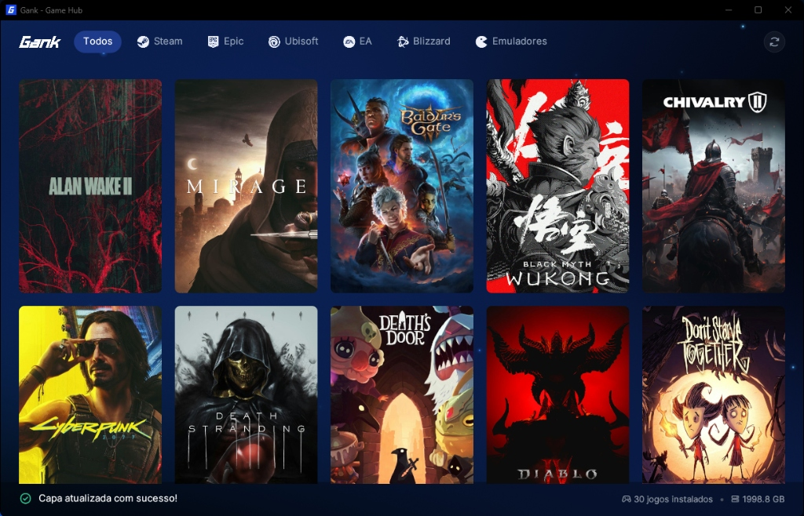

<div align="center">


# Gank

<p>
  <strong>Ultra-fast, minimalist desktop game aggregator and launcher written in Rust</strong><br>
  Sub-100ms startup, zero allocations per frame, and ~32 MB idle memory footprint.
</p>

[](https://github.com/carllosnc/gank/actions/workflows/ci.yml)
[](https://github.com/carllosnc/gank)
[](LICENSE)

<br>



</div>

<br>

Gank unifies fragmented game libraries (Steam, Epic Games, EA App, Ubisoft Connect, Battle.net, and Emulators) into a single cinematic interface without the overhead of multiple store clients running in the background.

---

## Performance Principles

- **Zero Overhead at Idle**: Reactive user interface built with `egui` and rendered with `wgpu`. CPU usage drops below 0.4% when idle, and idle RAM stabilizes around ~30–40 MB with `mimalloc` and native working set trimming.
- **Lightweight Game Scanners**: Direct file system and registry manifest scanning (no slow network queries or heavyweight API initialization on startup).
- **Sub-100ms Startup**: Native compiled executable launching in under 90 milliseconds.
- **Direct Launching**: Instant game execution through native protocol URIs or direct executables with automatic background launcher bootstrapping.

---

## Tech Stack

- **Language**: [Rust](https://www.rust-lang.org/) (2021 Edition)
- **GUI & Graphics**: [egui](https://github.com/emilk/egui) / [eframe](https://github.com/emilk/egui/tree/master/crates/eframe) with [wgpu](https://wgpu.rs/) rendering backend
- **Memory Allocator**: [mimalloc](https://github.com/microsoft/mimalloc) (zero fragmentation, high throughput)
- **Platform Integrations**: Windows Registry (`winreg`), Win32 APIs, process utilities
- **Shaders**: Real-time WGSL procedural cosmic dust and organic mesh gradient

---

## Project Structure

```text
gank/
├── assets/              # Inter fonts, high-resolution official brand icons, preview
├── src/
│   ├── main.rs          # Entry point, eframe setup, WGPU pipeline and Windows App ID
│   ├── models.rs        # Core data structures (Game, Platform, LaunchCommand)
│   ├── config.rs        # Application configuration and API keys persisted to disk
│   ├── artwork.rs       # Cover art caching, ffmpeg video conversion and thumbnailing
│   ├── metadata/        # Async metadata enrichment (Steam Store, RAWG, SteamGridDB)
│   ├── scanners/        # Local scanners (Steam, Epic, EA, Ubisoft, Battle.net, Emulators)
│   └── ui/              # Egui components, WGSL shaders, design system and views
├── AGENTS.md            # AI agent guidelines, architecture rules and governance
├── ROADMAP.md           # Milestone roadmap for v0.1.0 and beyond
├── RELEASING.md         # Release procedure, quality gates, and publishing guide
├── CHANGELOG.md         # Documented release history and version notes
├── Cargo.toml
├── LICENSE
└── README.md
```

---

## Roadmap & Guidelines

- For release status and planned milestones, see [`ROADMAP.md`](ROADMAP.md).
- For release procedures and packaging instructions, see [`RELEASING.md`](RELEASING.md).
- For version history and change logs, see [`CHANGELOG.md`](CHANGELOG.md).
- For coding standards, anti-regression performance rules, and architecture governance, see [`AGENTS.md`](AGENTS.md).

---

## Getting Started

### Prerequisites
- [Rust & Cargo](https://rustup.rs/) (stable toolchain)
- Windows 10/11 (or Linux via Proton/Wine)

### Running in Development
```powershell
cargo run
```

### Building the Optimized Release Binary
```powershell
cargo build --release
```

The optimized production binary will be generated at `target/release/Gank.exe`.

---

## License

Distributed under the MIT License. See [`LICENSE`](LICENSE) for details.
